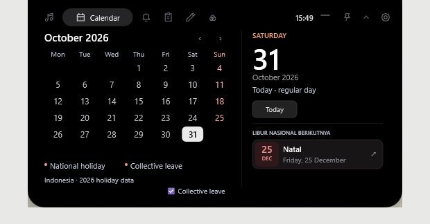
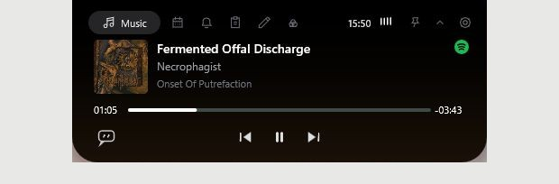
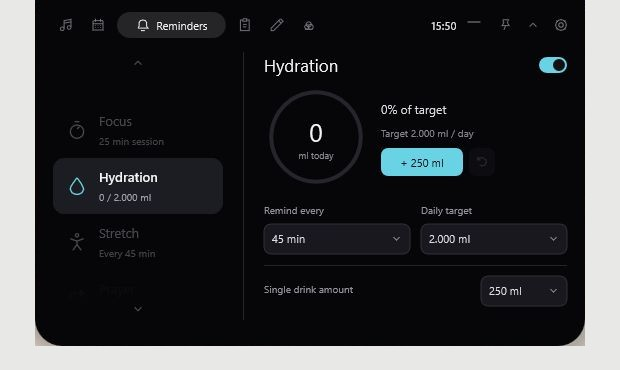
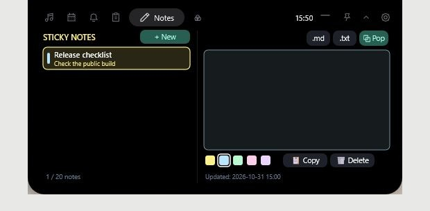
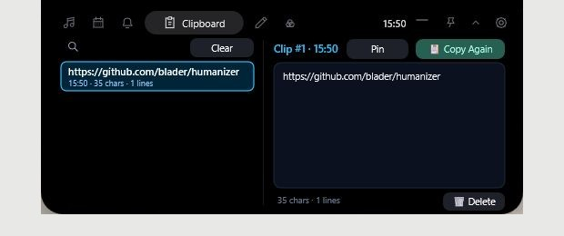
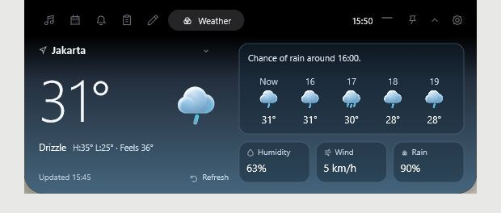
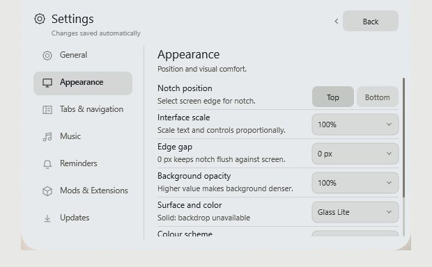

# mynotch

A portable notch for Windows that keeps music controls, your calendar, reminders, and quick notes at the edge of the screen.

Built with Rust, Direct2D, and DirectWrite. The interface uses native Windows APIs and does not need an Electron or Chromium runtime.

**Current release: v0.0.2 (preview)** · [Download for Windows x64](https://github.com/arwankemis/mynotch/releases/tag/v0.0.2) · [Changelog](CHANGELOG.md)

## Three stages

| Stage 0: minimal | Stage 1: compact | Stage 2: expanded |
|:---:|:---:|:---:|
| [](docs/images/stage-0.jpg) | [](docs/images/stage-1.jpg) | [](docs/images/calendar.jpg) |
| Small notch in minimal mode. Hover to reveal the bar. | Default resting view with time and contextual status. Click to expand. | Interactive tabs for music, calendar, reminders, and enabled mods. |

Scroll over Stage 0 or 1 to adjust Windows master volume. Laptop and Bluetooth battery levels appear when Windows reports them; this desktop capture has neither. The compact views use the same scale as the expanded panel.

## Screenshots

| Music | Reminders | Notes |
|:---:|:---:|:---:|
| [](docs/images/music.jpg) | [](docs/images/reminders.jpg) | [](docs/images/notes.jpg) |
| Windows media controls, seek bar, and lyrics access. | Water intake, targets, and reminder intervals. | Color-coded notes, Markdown/text export, and desktop pop-out. |
| **Clipboard** | **Weather** | **Appearance** |
| [](docs/images/clipboard.jpg) | [](docs/images/weather.jpg) | [](docs/images/settings.jpg) |
| Search, pin, and reuse copied text. | Current conditions and hourly forecast via Open-Meteo. | Position, scale, colors, and materials. Solid fallback shown. |

Click a screenshot to view it at full size. All nine captures use the **public v0.0.2 release executable** and separate preview data. Notes uses a sample checklist; weather shows the Jakarta preset. [Screenshot notes](docs/images/README.md).

<details>
<summary>Feature details, optional mods, and privacy</summary>

### Music controls and lyrics

Play, pause, skip tracks, and seek from the notch. mynotch reads the Windows media session, so it works with players and browser media that expose Windows transport controls. Available actions depend on the player.

There is also an audio spectrum visualizer and a synchronized lyrics view, with CJK romanization support. Lyrics availability depends on the track and network response. The visualizer uses system audio output, not the microphone.

The volume HUD handles notch scrolling and volume-key changes. While mynotch is running, it attempts to suppress the Windows volume overlay so volume feedback stays in the notch.

### Calendar and holidays

Browse months with the mouse wheel, check Indonesian national holidays and collective leave days, and see the selected day's details. The date updates automatically at midnight.

### Reminders you can adjust

Track water intake against a daily target and choose when to get a drink reminder. The reminder panel also includes a focus timer with work and break intervals, movement and eye-rest reminders, and prayer schedules for configured locations. Each reminder has its own settings.

### Notes that can leave the notch

Keep short notes in the panel, choose a color, or use **Pop** to put a note in a floating desktop window. Notes save automatically and can be exported as Markdown or plain text. The screenshot uses a sample checklist.

Notes is an optional built-in mod. Enable it under **Settings > Mods & Extensions** to add its tab.

### Clipboard history with search and pinning

Find copied text, pin snippets you reuse, and copy an entry again. Clipboard history is disabled by default; enable its tab in Settings when you want to use it.

In v0.0.2, ordinary entries expire after 24 hours and pinned entries after 30 days. Each entry is limited to 64 KiB. mynotch respects supported clipboard exclusion flags used by password managers, but cannot identify every sensitive text item. History is stored locally as plain text in `data/state.json`.

### Weather without an API key

See current conditions, feels-like temperature, hourly forecasts, humidity, wind, and rain probability. Weather uses Open-Meteo and supports city presets or custom coordinates. The background changes with the weather and time of day.

Weather is an optional built-in mod, available under **Settings > Mods & Extensions**. The screenshot shows the Jakarta preset; readings change over time.

### Appearance and behavior

Place the notch at the top or bottom, change its scale and edge gap, and choose a light or dark color scheme. **Settings > Appearance** has three material choices: Solid, Glass Lite, and Glass Adaptive. Glass effects depend on Windows backdrop support and can fall back to Solid, as shown in this capture.

Stage and tab changes use spring animation. Reduced motion and automatic hiding during fullscreen use are configurable. The interface supports English and Indonesian.

### Optional mods and extensions

Manage built-in tools and community packages under **Settings > Mods & Extensions**. Community mods can be installed from `.zip` packages or JSON manifests; [examples](examples/mods/) include a currency converter, Lua counter, and IHSG monitor.

Lua scripts run in the Piccolo sandbox with instruction limits. Network access requires permission, and v0.0.2 blocks private and reserved network destinations by default. A mod needs a user button click before opening a browser link or copying text through its action API. Catalog entries marked as planned are not available to install yet.

### Bluetooth status and privacy indicators

Connected Bluetooth audio devices can show battery levels in Stage 1 and brief connection notices. Battery reporting depends on the device and Windows driver.

mynotch also has microphone and camera activity indicators. These reflect activity Windows makes available to the app; screen-capture detection is not supported.

</details>

[Panduan penggunaan, mod, data, dan build](docs/README.md).

## Download and run

1. Download `mynotch-0.0.2-windows-x64.zip` from [Releases](https://github.com/arwankemis/mynotch/releases).
2. Extract it to a folder you can write to. Keep `mynotch.exe` and `libunwind.dll` together.
3. Run `mynotch.exe`.

No installer is required. Settings, notes, and clipboard history stay in the `data/` folder beside the executable. Copy that folder to back up your data or move it with the app.

Windows 10 or 11, 64-bit, is required. Rendering uses Direct3D 11 and Direct2D, with a WARP software fallback when hardware rendering is unavailable. Online features such as weather, lyrics lookup, and update checks need an internet connection.

### Updating

**Settings > Updates** checks GitHub releases, downloads the public update package over HTTPS, and validates its SHA-256 checksum before replacement. The updater includes rollback handling if an update fails.

If you are upgrading from **v0.0.1.4 or earlier**, download and extract v0.0.2 manually once. Older versions cannot discover the required checksum reliably. In-app updating is supported from v0.0.2 onward.

Version 0.0.2 also adds clipboard retention, stricter extension network rules, recovery handling for corrupt settings, and atomic note exports. See the [release changes](CHANGELOG.md#002---2026-10-31) for details.

## Controls

| Input | Action |
|---|---|
| Hover over Stage 0 | Reveal the compact bar |
| Click the compact bar | Open the full panel |
| `Alt + N` | Toggle the notch; configurable in Settings |
| Mouse wheel over Stage 0 or 1 | Adjust Windows master volume |
| Mouse wheel over the calendar | Change month |
| Mouse wheel over clipboard history | Navigate history pages |
| `Esc` | Dismiss a popup or return from the current view |
| `Tab` / `Shift + Tab` | Move keyboard focus |
| `Space` / `Enter` | Activate the focused control |
| `Ctrl + A` | Select all text in an input field |

## Build from source

Use a Windows Rust toolchain and PowerShell 5.1 or newer. The build script defaults to `x86_64-pc-windows-gnullvm`; you can select `x86_64-pc-windows-msvc` with `-Target`. Building the hardware sensor provider requires the .NET 10 SDK.

```powershell
git clone https://github.com/arwankemis/mynotch.git
cd mynotch
powershell -ExecutionPolicy Bypass -File scripts\build.ps1
```

The public executable is written to `dist/public/mynotch.exe` and copied to the repository root. To run the unit tests:

```powershell
powershell -ExecutionPolicy Bypass -File scripts\build.ps1 -Test
```

The release display version comes from [`release/version.json`](release/version.json).

## License

[MIT](LICENSE). See [third-party notices](THIRD_PARTY_NOTICES.md) for bundled components and their licenses.

